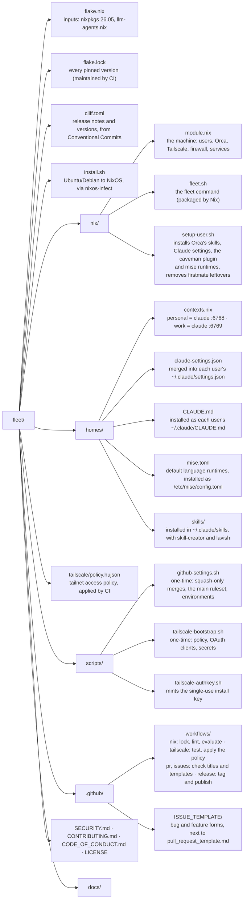

# fleet

Hand off coding tasks to agents on your own server. Check in from your phone while they work around the clock.

You start agents per account from the Orca app on your Mac or phone, and Orca runs each one in its own worktree and terminal on the VPS. Personal and work run as separate Linux users, so their logins and repos never mix. You follow every agent's terminal live and pick up its GitHub work from the app.

Under the hood: [Orca](https://github.com/stablyai/orca) runs headless to host the agents, its own `orca-cli` and `orchestration` skills are installed globally for each harness, and a **NixOS** VPS declared in this flake ties it together.

> [!NOTE]
> This is my personal setup, tuned to how I work: my accounts, my models, my VPS. Use it and try it out, I recommend it. But I encourage you even more to build your own, and to treat this repo as inspiration rather than a product. If you fork it, point `FLEET_REPO` in `install.sh` at your fork.

| Context | Linux user | Agents | Models | Orca port |
|---|---|---|---|---|
| `personal` | `personal` | Claude Code | Claude Opus 5.5 / Fable 5.1 | 6768 |
| `work` | `work` | Claude Code | Claude Opus 5.5 / Fable 5.1 | 6769 |

The whole machine is declared in this flake: users, firewall, Tailscale, both Orca servers, and every version (pinned in `flake.lock`). Orca and Claude Code (and Pi, if a context picks it) come from numtide's [llm-agents.nix](https://github.com/numtide/llm-agents.nix), prebuilt in their binary cache.

## Quick start

1. Once per repo, in a fork: run `scripts/github-settings.sh`, set up Tailscale and publish a first release ([One-time repo setup](docs/installation.md#one-time-repo-setup)). Once per tailnet: generate a Tailscale access token and run `scripts/tailscale-bootstrap.sh` (see [Tailscale access](docs/installation.md#tailscale-access)).
2. Create a dedicated `~/.ssh/fleet` key, add the `fleet`, `fleet-personal` and `fleet-work` hosts to `~/.ssh/config` ([SSH key and config](docs/installation.md#ssh-key-and-config)), and let root accept the key (NixOS disables password logins):
   ```bash
   ssh-copy-id -i ~/.ssh/fleet.pub fleet
   ```
3. From this repo on your computer:
   ```bash
   ssh -t fleet "curl -fsSL https://github.com/flpdorea/fleet/releases/latest/download/install.sh | TS_AUTHKEY=$(scripts/tailscale-authkey.sh) bash"
   ```
   This **wipes the VPS** (it asks you to type `nixos` first), installs NixOS and reboots. On first boot, the machine applies this flake by itself. It installs the latest release and keeps to releases; to follow `main` instead, see [Releases](docs/operations.md#releases).
4. For each context:
   ```bash
   ssh fleet-personal
   fleet login    # git identity, GitHub, and the Claude (or Pi) login
   fleet pair     # link for the Orca app
   ```
   Add the server in the Orca app with that link and start agents from there. `fleet` alone lists the commands.

The full walkthrough, including what to watch during the first boot, is in [docs/installation.md](docs/installation.md).

## Everyday commands

| Command | Run as | What it does |
|---|---|---|
| `fleet` | anyone | list the commands |
| `fleet status` | context user | setup and Orca server state |
| `fleet pair` | context user | link that connects the Orca app to this server |
| `fleet login` | context user | git identity, GitHub and the agent's login |
| `fleet services` | context user or root | state of the context's services and when the polled ones run next |
| `fleet start\|stop\|restart <service>` | context user or root | manage `orca`, `setup`, `pr-ready` or `agent-comments`; root acts on every context unless given `--context <ctx>` |
| `fleet run <service>` | context user or root | run `pr-ready` or `agent-comments` once, now |
| `fleet logs <service>` | context user or root | the end of the service's log; `-f` follows it |
| `fleet rebuild` | root | update to the latest release (or the branch it follows) and apply it |

## Repository layout



## Documentation

| Guide | Covers |
|---|---|
| [Architecture](docs/architecture.md) | How the pieces fit, why one Linux user per context, the security model |
| [Installation](docs/installation.md) | Prerequisites, the install command, first boot, logins, pairing |
| [Configuration](docs/configuration.md) | Contexts, Orca skills, language runtimes, adding a context |
| [Operations](docs/operations.md) | Daily use, updates, restarts, troubleshooting |

## Known limits

- Orca's skills come from the Orca repo through `npx skills`, and the `lavish` skill runs the latest `lavish-axi` CLI through `npx`, and the caveman Claude Code plugin is updated from its GitHub repo on every rebuild; those are the only parts not pinned by `flake.lock`.
- Each Orca server uses a fair amount of memory. Contabo's guide recommends 12 GB for one; with two servers and several workers, size up.

## Contributing and license

Issues and pull requests are welcome; see [CONTRIBUTING.md](CONTRIBUTING.md), and report vulnerabilities privately as described in [SECURITY.md](SECURITY.md). Released under the [MIT License](LICENSE).
